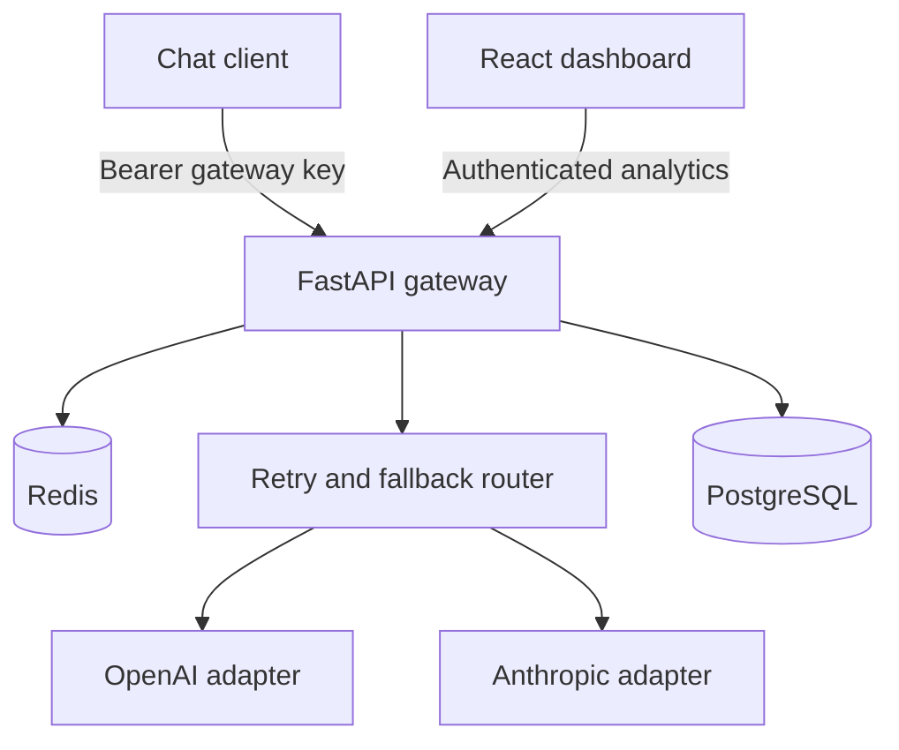

# LLM Gateway

## Overview

LLM Gateway gives applications a single authenticated API for OpenAI and Anthropic, bringing provider routing, failure handling, usage controls, and cost visibility into one backend service.

Clients select a model alias such as `fast` or `smart`. The gateway handles provider-specific requests, retries transient failures, optionally falls back to another provider, and records usage for a React dashboard.

## Live demo

**[View dashboard](https://llm-gateway-private-demo.onrender.com)** · **[Request access](https://www.linkedin.com/in/mohibz/)**

The dashboard requires a private gateway key, available on request. Credentials are not embedded in the frontend or published in this repository.

Hosted on **Render**, with **Neon PostgreSQL** and **Upstash Redis**. The free hosting tier may take about a minute to wake after inactivity.

## Tech stack

- **Backend:** Python, FastAPI, Pydantic, HTTPX, Uvicorn
- **Frontend:** React, Vite
- **Storage:** PostgreSQL for telemetry and managed keys, Redis for rate limiting and caching
- **Deployment:** Docker, Render, Neon, Upstash
- **Testing and CI:** pytest, Node.js test runner, GitHub Actions

## Main features

- **Unified chat API:** One authenticated `POST /v1/chat` endpoint with configurable model aliases for OpenAI and Anthropic.
- **Retries and fallback:** Bounded retries for transient failures, optional provider fallback, and explicit provider selection.
- **Usage controls:** Per-key rate limits, request-size limits, and concurrency limits enforced before provider calls.
- **Response caching:** Opt-in caching isolated by gateway key, avoiding additional provider calls for eligible repeated requests.
- **Usage dashboard:** Request history, provider breakdowns, token usage, estimated USD costs, latency, and success/cache-hit rates.
- **Gateway-key management:** Protected endpoints to create, list, and revoke managed keys.

## Architecture

Requests pass through authentication, validation, rate limiting, and cache lookup before provider routing. A cache hit skips the provider call. PostgreSQL stores request telemetry, which powers analytics scoped to the authenticated gateway key.

## Key design decisions

### Bound failures and provider work

Retries apply to timeouts, HTTP 429, and HTTP 5xx responses. Nontransient errors stop without fallback, while an explicit provider selection keeps the request on that provider. A shared routing deadline bounds provider attempts and backoff, with request-size and concurrency limits controlling admitted work.

### Isolate access and cached responses

Gateway keys authenticate clients separately from upstream provider credentials. Managed-key secrets are returned once and stored as hashes, and cache fingerprints include the gateway-key identifier to prevent response reuse across keys. The dashboard holds its key in page memory.

### Record usage without retaining conversations

PostgreSQL stores tokens, latency, outcomes, routing attempts, and estimated costs without storing raw messages or response text. Cached response text remains in Redis until expiry. Telemetry writes are best effort so a database-write failure does not replace a successful chat response.

### Make cost estimates traceable

Costs use the final provider’s reported token usage, returned model ID, and versioned pricing rates. Cache hits record zero additional provider tokens and cost. Missing pricing produces an unpriced result rather than treating the request as free.

## Testing and verification

Recorded verification passed **119 backend tests** with local Redis and PostgreSQL, plus **3 frontend tests** and a dashboard production build.

Coverage includes authentication and revocation, retries, fallback, routing deadlines, cache isolation, rate limiting, concurrency limits, analytics, and dependency failures. Automated tests use simulated providers and require no paid API calls.

Separate live checks verified successful requests through the deployed gateway to both **OpenAI and Anthropic**, including persisted usage and dashboard cost estimates. A simulated workload also verified cache hits, successful fallback, and telemetry recording.

**[View CI runs](https://github.com/syedmohibimamzaidi/llm-gateway/actions)**

## Known limitations

- Free hosting introduces cold starts. Live checks establish functionality, not production-scale performance or availability.
- Chat is text-only and nonstreaming.
- Telemetry has no durable replay queue, so failed writes can leave dashboard totals incomplete.
- Costs are estimates rather than invoices and exclude some billing adjustments and usage from failed attempts.
- Gateway controls limit request volume and concurrency, but do not enforce a hard monetary spending cap. Paid provider access is owner-controlled.

## Author

Mohib Zaidi
